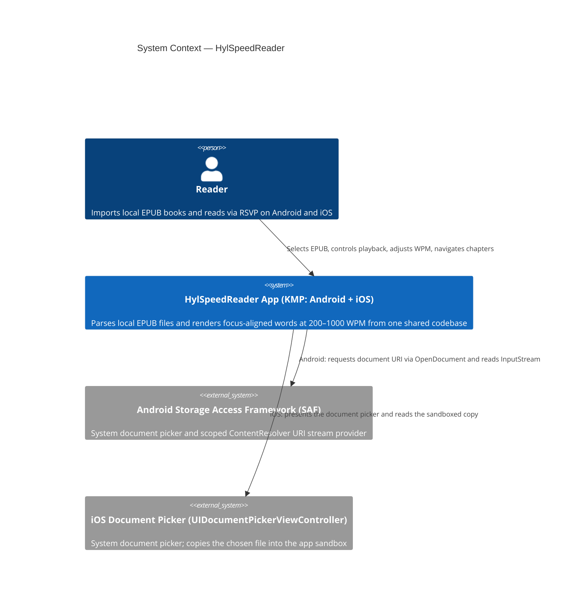

# Architecture — HylSpeedReader

> **Verification Notice:** Concrete file paths and component names reflect confirmed HylSpeedReader specifications. Inspect `settings.gradle.kts`, `composeApp/build.gradle.kts`, and `composeApp/src/` to verify exact root package names, targets, and Gradle configuration details. (This project does not use a Gradle version catalog — dependency versions are declared directly in the build scripts.)

## 1. Architectural Overview & Dependency Laws

**HylSpeedReader** (root package `eu.hylatwork.hylspeedreader`) is a **Kotlin Multiplatform (KMP)** application targeting **Android and iOS** from one shared codebase, written in **Kotlin** using **Compose Multiplatform (Material 3)** and **Kotlin Coroutines / Flow**. The code lives in a single KMP module `composeApp`, split into `commonMain` (shared), `androidMain` and `iosMain`; the iOS app is wrapped by `iosApp/` (Xcode) and built in CI by `codemagic.yaml` at the repo root. The system enforces a strict three-layer unidirectional architecture (**UI $\rightarrow$ Domain $\leftarrow$ Data**):

- **Domain Layer (`composeApp/src/commonMain/.../domain/`):** Pure Kotlin business logic and models (`Tokenizer`, `RsvpWord.focusIndexFor()`, `Typography.canonical()`, `RsvpTiming.delayMs()`, `RsvpTicker.indices()`, plus the `RsvpWord`, `Chapter`, and `ReadingPosition` models). **Zero** dependencies on Android framework classes, Compose, `ViewModel`, or any XML/HTML parser (it may use plain `kotlinx.coroutines`, which is platform-free).
- **Data Layer (`composeApp/src/*/.../data/`):** A platform-agnostic port surface in `commonMain` — `EpubBook`, `EpubEngine` + `createEpubEngine()`, `DocumentHandle`, `Platform` (expect/actual: engine, settings, logger, IO dispatcher) and `SettingsReadingPositionStore` (multiplatform-settings → SharedPreferences / NSUserDefaults) — with the concrete Android EPUB codec in `androidMain` (`EpubParser`, `EpubDocument`, `EpubSpine`, `EpubCharset`, `EpubTextExtractor`, `XmlDom`) over `java.util.zip` and the **platform XML DOM** (`javax.xml`/`org.w3c.dom`), plus a dependency-free portable codec in `commonMain` (`data/epub/portable/`: `PortableZip`, `Inflate`, `PortableXml`, `PortableCharset`, `PortableTextExtractor`, `PortableEpub`/`PortableEpubParser`) that the iOS `EpubEngine` actual uses. The shared `XmlEntities` table also lives in `commonMain`. **Zero** dependencies on Compose, `ViewModel` or `Activity` — and **no third-party parser**. Both platforms can open books (DC-4): Android over `java.util.zip`/`javax.xml`, iOS over the pure-Kotlin portable codec.
- **UI Layer (`composeApp/src/commonMain/.../ui/`):** Lifecycle-aware state orchestration (`ReaderViewModel`, `ReaderUiState`, `PlaybackStatus`, `ReaderError`) and Material 3 Composables (`ReaderScreen`, `RsvpWordView`, `PlayerControls`, `ChapterDrawer`, `EmptyState`, `HylIcons`), plus the platform picker seam `rememberEpubPicker`. Leaf Composables are stateless; `ReaderScreen` is the single stateful host, and platform service wiring lives only in `ui/ReaderEntryPoint` (`rememberReaderViewModel()`).

**Release packaging:** `./gradlew :composeApp:assembleRelease` produces an unsigned APK at `composeApp/build/outputs/apk/release/composeApp-release-unsigned.apk` (debug: `composeApp-debug.apk`). The `copyReleaseApkToDist` Gradle task is finalized by `assembleRelease` and copies the built APK into the `sys-src/dist/` drop-point (version-control-ignored apart from `.gitkeep`). The iOS `ComposeApp.framework` is produced on macOS by `:composeApp:embedAndSignAppleFrameworkForXcode` (driven by the Xcode build phase) or `:composeApp:linkReleaseFrameworkIosArm64`; Codemagic builds an unsigned simulator `.app` today and a signed `.ipa` once Apple credentials are added.

---

## 2. C4 System Context Diagram

---

## 3. C4 Container & Component Diagram

```mermaid
C4Component
    title Component Architecture — HylSpeedReader

    Container_Boundary(ui_layer, "UI Layer (Compose Multiplatform, commonMain)") {
        Component(main_activity, "MainActivity", "ComponentActivity (androidMain)", "Android host: Platform.init(), edge-to-edge, setContent { App() }")
        Component(theme, "HylSpeedReaderTheme", "Composable (ui/theme/)", "Material 3 light/dark scheme; platform dynamic colour via expect/actual")
        Component(reader_screen, "ReaderScreen", "Composable (ui/reader/)", "Top-level screen coordinating empty, loading, error, and active reading states; owns the OpenDocument() launcher, drawer and snackbar host")
        Component(rsvp_view, "RsvpWordView", "Composable (ui/rsvp/)", "Measures prefix + focus glyph via Compose TextMeasurer for pixel-exact horizontal focus alignment")
        Component(player_controls, "PlayerControls", "Composable (ui/reader/)", "Play/pause, seek/scrubbing, and 200–1000 WPM slider")
        Component(chapter_drawer, "ChapterDrawer", "Composable (ui/reader/)", "Modal/navigation drawer listing parsed chapters for direct jump")
        Component(empty_state, "EmptyState", "Composable (ui/reader/)", "Initial call-to-action shown while no book is loaded; invokes the host screen's OpenDocument() launcher")
        Component(icons, "HylIcons", "Vector drawables (ui/theme/)", "Hand-authored play/pause/skip transport glyphs (replaces material-icons-extended)")
        Component(view_model, "ReaderViewModel", "ViewModel (ui/)", "Exposes immutable StateFlow; drives cold Flow<Int> RSVP tick loop on Dispatchers.Default")
        Component(reader_ui_state, "ReaderUiState", "Model (ui/)", "Immutable UI snapshot plus the PlaybackStatus state machine")
    }

    Container_Boundary(domain_layer, "Domain Layer (Pure Kotlin, commonMain)") {
        Component(tokenizer, "Tokenizer", "Kotlin (domain/logic/)", "Deterministic word/punctuation/paragraph segmentation")
        Component(rsvp_word, "RsvpWord", "Model (domain/model/)", "Holds token metadata and computes focusIndexFor() via standard focus-index length buckets")
        Component(rsvp_timing, "RsvpTiming", "Kotlin (domain/logic/)", "Computes delayMs() from 200–1000 WPM + sentence, clause, numeral, length, and paragraph heuristics")
        Component(typography, "Typography", "Kotlin (domain/logic/)", "Canonicalises smart punctuation for recognition without rewriting the text")
        Component(rsvp_ticker, "RsvpTicker", "Kotlin (domain/logic/)", "Android-free cold Flow<Int> cadence: emits each word index then suspends for its delayMs(), re-reading WPM every tick")
        Component(chapter, "Chapter", "Model (domain/model/)", "Immutable spine-item metadata (index + title) shared by the data and UI layers")
        Component(reading_position, "ReadingPosition", "Model (domain/model/)", "Immutable restorable position value: book URI, chapter index, word index, WPM")
    }

    Container_Boundary(data_layer, "Data Layer (EPUB Ingestion & Extraction; platform seam in commonMain)") {
        Component(epub_parser, "EpubParser", "Kotlin (data/epub/)", "Reads ZIP entries via java.util.zip, resolves container.xml, coordinates extraction")
        Component(epub_spine, "EpubSpine", "Kotlin (data/epub/)", "Pure OPF spine resolution: skips linear=no and nav documents, filters media types, resolves relative hrefs")
        Component(xml_dom, "XmlDom / XmlEntities", "Kotlin (data/epub/)", "Hardened platform-DOM parsing (javax.xml) with DOCTYPE stripping and an embedded HTML entity table — replaces jsoup")
        Component(epub_document, "EpubDocument", "Kotlin (data/epub/)", "Open parsed EPUB; loads and tokenizes chapters lazily through a bounded LRU cache")
        Component(epub_charset, "EpubCharset", "Kotlin (data/epub/)", "Decodes entry bytes honouring a UTF BOM or the declared XML encoding")
        Component(text_extractor, "EpubTextExtractor", "Kotlin (data/epub/)", "Extracts readable block-level text and paragraph breaks from XHTML chapters via the platform DOM, with a tolerant tag-stripping fallback")
        Component(reading_position_store, "ReadingPositionStore", "Port (data/position/, commonMain)", "Persists the last reading position across process death")
        Component(reading_position_impl, "SettingsReadingPositionStore", "Kotlin (data/position/, commonMain)", "multiplatform-settings implementation of the port (SharedPreferences on Android, NSUserDefaults on iOS)")
        Component(epub_book, "EpubBook", "Interface (data/epub/, commonMain)", "Platform-neutral parsed EPUB: title, author, chapters, lazy loadChapter(), close()")
        Component(epub_engine, "EpubEngine / createEpubEngine()", "Interface + expect fun (data/epub/, commonMain)", "Opens a DocumentHandle into an EpubBook; Android actual = java.util.zip + javax.xml codec, iOS actual = shared pure-Kotlin portable codec (inflate + ZIP + XML)")
        Component(document_handle, "DocumentHandle", "Interface + expect fun (data/epub/, commonMain)", "Opaque picked-document handle (Android Uri / iOS NSURL) exposing persistedValue + takePersistableAccess()")
        Component(platform, "Platform", "expect object (data/, commonMain)", "Platform services: epubEngine(), settings(), logW(), ioDispatcher")
        Component(document_picker, "rememberEpubPicker", "@Composable expect fun (ui/, commonMain)", "System picker: SAF OpenDocument (androidMain) / UIDocumentPickerViewController (iosMain)")
    }

    System_Ext(saf_runtime, "Android SAF & ContentResolver", "ActivityResultContracts.OpenDocument() + InputStream")

    Rel(reader_screen, empty_state, "Renders when no book loaded")
    Rel(reader_screen, rsvp_view, "Passes current RsvpWord")
    Rel(reader_screen, player_controls, "Renders playback & WPM controls")
    Rel(reader_screen, chapter_drawer, "Renders chapter navigation")
    Rel(reader_screen, view_model, "Collects StateFlow via collectAsStateWithLifecycle()")
    Rel(reader_screen, reader_ui_state, "Renders immutable ReaderUiState snapshot")
    Rel(main_activity, theme, "Wraps content in HylSpeedReaderTheme")
    Rel(main_activity, reader_screen, "Renders as the root content")
    Rel(reader_screen, saf_runtime, "Launches OpenDocument() on request from EmptyState")

    Rel(view_model, reader_ui_state, "Publishes ReaderUiState / PlaybackStatus")
    Rel(view_model, epub_parser, "Imports EPUB from ContentResolver InputStream")
    Rel(view_model, reading_position_store, "Restores the last position on launch and saves progress")
    Rel(epub_parser, epub_spine, "Resolves the ordered spine entries")
    Rel(epub_parser, xml_dom, "Parses container.xml and the OPF metadata")
    Rel(epub_spine, xml_dom, "Parses the OPF manifest and spine")
    Rel(text_extractor, xml_dom, "Parses chapter XHTML")
    Rel(epub_parser, epub_document, "Produces the parsed, still-open EPUB")
    Rel(epub_parser, text_extractor, "Extracts chapter titles during parsing")
    Rel(epub_document, text_extractor, "Extracts paragraphs per chapter")
    Rel(epub_document, tokenizer, "Tokenizes extracted chapter text")
    Rel(epub_document, chapter, "Exposes Chapter metadata per spine item")
    Rel(epub_parser, epub_charset, "Decodes config/OPF bytes")
    Rel(epub_document, epub_charset, "Decodes chapter bytes")
    Rel(view_model, rsvp_ticker, "Collects the tick cadence on Dispatchers.Default")
    Rel(rsvp_ticker, rsvp_timing, "Queries delayMs() per tick")
    Rel(rsvp_timing, typography, "Canonicalises trailing punctuation before pacing")
    Rel(tokenizer, typography, "Canonicalises edge characters when trimming quotes")
    Rel(tokenizer, rsvp_word, "Constructs RsvpWord with focusIndexFor()")
    Rel(rsvp_view, rsvp_word, "Reads word text & precomputed focusIndex")
    Rel(player_controls, icons, "Renders transport glyphs")
    Rel(view_model, reading_position, "Restores and persists the ReadingPosition value")
    Rel(reading_position_impl, reading_position_store, "Implements the persistence port")
```

---

## 4. Key Architectural Decisions & Mechanisms

### AD-1: Dependency-Minimal EPUB Pipeline (`java.util.zip` + platform XML DOM)
- **Decision:** Parse EPUB archives directly using JDK `java.util.zip` and the platform `javax.xml`/`org.w3c.dom` DOM — no external EPUB *or* HTML/XML library (the former `jsoup` dependency has been removed).
- **Details:** `EpubParser` resolves `META-INF/container.xml`, locates the root `.opf` package document, then delegates spine ordering to the pure, Android-free `EpubSpine`, which drops `linear="no"` entry refs and the EPUB 3 navigation document (`properties="nav"`) so the TOC does not appear as a chapter, filters to document media types, and resolves relative (`../`) hrefs. It then hands the open archive to `EpubDocument`. Because the archive copy is a blocking read and the returned `EpubDocument` owns an open `ZipFile` plus a temp file, `parse` runs `NonCancellable`: a superseded import completes and its result is discarded via `EpubDocument.close()` by the caller rather than being lost to cancellation. `EpubDocument` streams each chapter's XHTML into `EpubTextExtractor` for block-element text extraction and tokenizes it on demand, caching the last few chapters in a bounded LRU. All entries are decoded through `EpubCharset` (UTF BOM or declared encoding) and parsed through `XmlDom`: a hardened, namespace-agnostic platform DOM that strips the document type declaration (so the external DTD is never fetched — the XXE guard), decodes the embedded `XmlEntities` table, escapes unknown references, and disables external entity resolution through both feature flags and a no-op entity resolver. ` `/block boundaries become spaces, noise (`script`/`style`/TOC `nav`) is skipped, and anything the strict XML parser rejects degrades to a tolerant tag-stripper instead of failing (NFR-2.2). A pure-Kotlin twin of this pipeline lives in `commonMain` (`data/epub/portable/`) and mirrors the same rules for the iOS engine, so both codecs share the `XmlEntities` table and produce equivalent extraction.

### AD-2: Domain-Isolated Focus-Index & Pacing Logic
- **Decision:** Keep `RsvpWord.focusIndexFor()`, `Tokenizer`, `RsvpTiming.delayMs()`, and the `RsvpTicker` cadence in pure Kotlin without Android imports.
- **Details:**
  - `RsvpWord.focusIndexFor()` implements standard focus-index word-length buckets and guarantees `0 <= index < word.length`. UI components read the precomputed index and never duplicate bucket logic.
  - `RsvpTiming.delayMs()` enforces the `200..1000` WPM range and applies multiplicative/additive heuristics for sentence endings (`. ! ? …`), clause punctuation (`, ; : — – ) ] }` and quotes), numerals, long words, and paragraph boundaries.
  - `Typography.canonical()` maps smart quotes, guillemets and CJK/fullwidth marks onto that ASCII table *at read time*, so variants are paced identically **without rewriting the text**: the token keeps the book's glyphs (`don’t` stays `don’t`, CJK `。` stays `。`) and focus indices are untouched. `Tokenizer` uses the same mapping only to recognise edge quotes when trimming. Closing quotes and brackets are boundary markers — an edge quote is neutralized (trimmed) to protect the focal alignment, and a surviving closer counts as a clause break.
  - `RsvpTicker.indices(words, start) { wpm }` is the cold `Flow<Int>` cadence itself, expressed without Android so it can be tested with virtual time (see §6). Keeping it in `domain/` is what makes the playback timing verifiable from a plain JVM unit test.

### AD-3: Coroutine-Safe RSVP Playback Loop (`ReaderViewModel`)
- **Decision:** Drive playback through the pure-domain `RsvpTicker` flow executed on `Dispatchers.Default` and managed within `viewModelScope`.
- **Details:**
  - Playback emission suspends via `delay(RsvpTiming.delayMs(...))` on `Dispatchers.Default`, keeping `Dispatchers.Main` completely free for rendering; chapter archive reads run on `Dispatchers.IO`.
  - State transitions (play, pause, WPM slider updates, chapter jumps, manual scrubbing) cancel or restart upstream collection cleanly (structured job cancellation) so duplicate tick loops or stale coroutine jobs cannot occur. While any async work is in flight (`isLoading`) the transport controls are disabled and `play()`/`seekToWord()` are no-ops, so no action ever operates on stale chapter data.

### AD-4: Pixel-Exact Focus Alignment (`RsvpWordView`)
- **Decision:** Use Jetpack Compose `TextMeasurer` to compute exact horizontal glyph offsets.
- **Details:** `RsvpWordView` measures the substring preceding the focus index (`word.substring(0, focusIndex)`) and the focus character itself (`word[focusIndex]`), shifting horizontal placement so the visual center of the focus character aligns consistently with the screen's fixed focal reticle regardless of proportional font metrics or Unicode glyph widths.

### AD-5: Invalidation-Token Async Work (`ReaderViewModel`)
- **Decision:** Track *every* async unit of work (import, chapter load, tick) in its own job and gate the import and chapter-load completions on monotonically increasing tokens rather than relying on cancellation alone.
- **Details:** `openEpub`/`selectChapter` each cancel the previous job and capture the current token; because archive reads are not cooperatively cancellable mid-IO, the worker re-checks its token after `EpubParser.parse`/`EpubDocument.loadChapter` returns and before touching `_uiState`, so a slower superseded import or load can never overwrite the state of a newer one, leak a parsed document, or surface a spurious error. `stopOpen`/`stopChapterLoad`/`stopTicker` are called from `onCleared`, so nothing outlives the ViewModel.

### AD-6: Resource-Backed Strings & Accessible Controls
- **Decision:** All user-facing text — including the manifest label and the RSVP placeholder — lives in `res/values/strings.xml`, and every interactive control carries an accessibility label.
- **Details:** Composables read strings through `stringResource(...)`/`pluralStringResource(...)`; `RsvpWordView`'s placeholder defaults to the resource rather than a literal. `ReaderViewModel` emits resource-backed failure messages (`error_open_epub` / `error_load_chapter`) and logs the underlying exception to Logcat, so raw internals are never shown to the user. Both sliders set an explicit `contentDescription` (`Reading position` / `Reading speed`) and the scrub slider additionally exposes a `stateDescription` (the word-count readout) so assistive technology can announce the position. The RSVP panel uses the full-opacity `surfaceVariant` container so it inherits Material 3's designed on-surface contrast pairings instead of an ad-hoc alpha. The rapidly-flipping word itself is deliberately kept out of the accessibility tree (`clearAndSetSemantics`) — announcing ~17 words/second would be unusable — so the labelled transport controls carry the accessible interaction. A launcher icon is provided as an adaptive icon (`mipmap-anydpi-v26/`, with a `monochrome` layer) plus a `mipmap-anydpi/` fallback for API < 26, and the foreground is a pure-vector `drawable/`. While playback is running the scrub slider deliberately withholds its `stateDescription`, so a position that changes on every word tick is never announced (NFR-3.1).

### AD-7: Brand Palette, Dynamic Color & Responsive Layout
- **Decision:** Theme the UI with a navy brand palette, opt into wallpaper-derived dynamic color on Android 12+, and cap the reading column's width so the layout holds up on tablets, foldables and landscape.
- **Details:**
  - `HylSpeedReaderTheme(dynamicColor = true)` uses `dynamicLight/DarkColorScheme` when `SDK_INT >= S` and otherwise the explicit `NavyLightScheme`/`NavyDarkScheme` (brand primary/secondary with contrast-checked container pairs; tertiary/error/surface stay on the M3 baseline). The RSVP focal character keeps the baseline `error` role so it remains the single highest-salience element. `themes.xml` sets `windowBackground` to a colour matching the Compose surface so the edge-to-edge system-bar area does not flash during startup.
  - The transport controls sit on one `surfaceContainerHigh` dock (grouped, distinct from the reading stage); chapters are rendered with the Material 3 `NavigationDrawerItem`, which supplies the selected-pill indicator and the "selected" semantics for free.
  - `ReaderScreen` centres a column capped at `640.dp`; the RSVP stage uses `heightIn(min = …)` so it expands to fill the available space instead of floating as a fixed strip. On short viewports (phone landscape, small foldables) the screen switches to a compact mode — a smaller RSVP stage (box height and font size) and a tighter transport dock (padding and play-button size) — so nothing is clipped and the fixed focal centre does not drift (NFR-4.2).

### AD-8: Reading-Position Persistence (`ReadingPositionStore`)
- **Decision:** Persist the last reading position behind a small data-layer port (`ReadingPositionStore`), implemented with `SharedPreferences` — no new dependency and no extra persistence framework.
- **Details:**
  - The port lives in `data/position/` and depends only on the pure `domain` `ReadingPosition` value, so the UI layer talks to behaviour rather than to platform storage. `SettingsReadingPositionStore` writes through `multiplatform-settings` (SharedPreferences on Android, NSUserDefaults on iOS), so a save on the playback path never blocks a frame (NFR-1.3).
  - At import time `ReaderViewModel` calls `handle.takePersistableAccess()` (best-effort) so the Android document URI can be reopened after a restart; on iOS the picker copies the file into the sandbox. Without access the restore simply fails and starts clean. `ReadingPosition.validOrNull()` drops a corrupt/blank stored position.
  - Snapshots are taken on pause, seek, chapter change, roughly every 25 words while playing, and in `onCleared`, so at most a few seconds of progress can be lost. On launch a saved position is restored through the same `openEpub` path with a `startChapter`/`startWord`; a stale entry silently degrades to the empty state (FR-7.2) instead of surfacing an error.

### AD-9: Kotlin Multiplatform / Compose Multiplatform Split & Platform Seam
- **Decision:** Host all shared logic in a single KMP module `composeApp` (`commonMain`), push every platform-specific concern behind a small, explicit `expect`/`actual` seam, and keep the Android EPUB codec unchanged in `androidMain`.
- **Details:**
  - **Placement:** `commonMain` holds the domain, the ViewModel, the Material 3 Composables, the port surface (`EpubBook`, `EpubEngine`, `DocumentHandle`, `Platform`, `SettingsReadingPositionStore`), the shared `XmlEntities` table and the strings (`composeResources/values/strings.xml`, read through `Res.string.*`). `androidMain` holds `MainActivity`, the SAF picker, the `java.util.zip` + `javax.xml` EPUB codec, and the actuals. `iosMain` holds `MainViewController`, the `UIDocumentPickerViewController` picker, `NSUserDefaults` settings, and the `EpubEngine` actual, which reads the sandboxed copy and delegates to the shared pure-Kotlin portable codec.
  - **Seam:** `Platform` (expect object) exposes `epubEngine()`, `settings()`, `logW()` and `ioDispatcher`; `DocumentHandle` is a common interface whose platform implementations carry the underlying `Uri`/`NSURL`; `createEpubEngine()` and `persistedStringToDocumentHandle()` are top-level `expect` functions; `rememberEpubPicker` and `platformDynamicColorScheme` are `@Composable expect` functions.
  - **Why a seam rather than a rewrite:** the Android codec relies on `java.util.zip` and the JVM `javax.xml` DOM. Rather than port those platform APIs, the iOS actual reuses a shared, dependency-free codec added to `commonMain/data/epub/portable/` — a pure-Kotlin DEFLATE decoder (`Inflate`), a ZIP central-directory reader (`PortableZip`), a tolerant XML tree (`PortableXml`) and a block-level text extractor (`PortableTextExtractor`). It is JVM-tested and reads the sandboxed copy into memory. Android behaviour is unchanged and both platforms can open books (DC-4).
  - **ViewModel portability:** `ReaderViewModel` no longer subclasses `AndroidViewModel`; it takes an injected `EpubEngine` and `ReadingPositionStore`, uses `Platform.ioDispatcher`/`Platform.logW`, and emits `ReaderError` keys (mapped to strings in the UI) instead of reading Android resources.

---

## 5. Data Model

Immutable value types cross the layer boundaries; the UI renders snapshots rather than mutating shared state.

- **`RsvpWord`** (`domain/model/`) — one display-ready token: `raw`, `focusIndex`, the pre-split `prefix` / `focusChar` / `suffix`, and `endsParagraph`. `focusIndexFor(length)` maps word length to the focus index via fixed buckets (short words to `0`, then `1`, `2`, `3`, `4`), guaranteeing `0 <= index < length`. Built by `Tokenizer`, read read-only by `RsvpWordView`.
- **`Chapter`** (`domain/model/`) — immutable spine-item metadata: `index` and `title`. Produced by the data layer, listed by `ChapterDrawer`.
- **`ReadingPosition`** (`domain/model/`) — the restorable last position: `bookUri`, `chapterIndex`, `wordIndex`, `wpm`; `validOrNull()` drops a blank URI and clamps negative indices. Persisted through the `ReadingPositionStore` port.
- **`ReaderUiState`** (`ui/`) — the immutable snapshot rendered by `ReaderScreen`: loading flag, book/author and chapter titles, chapter list + selection, `chapterWordCount`, `currentWordIndex`, the current `RsvpWord?`, `wpm`, `status`, and `error: ReaderError?` (an enum key mapped to a localised string in the UI); exposes derived `hasBook` and `progress` (0..1) for the seek slider.
- **`PlaybackStatus`** (`ui/`) — sealed state machine: `Idle`, `Playing`, `Paused`, `ChapterEnd`.

---

## 6. Architectural Invariants & Boundary Verification

The JVM unit test `composeApp/src/androidUnitTest/kotlin/eu/hylatwork/hylspeedreader/ArchitectureGuardTest.kt` (run via `./gradlew :composeApp:testDebugUnitTest`) enforces the following invariants by scanning every KMP source root (`commonMain`/`androidMain`/`iosMain`) of `composeApp`, so no Android runtime is required:
1. `domain/` classes must have **zero** imports from `android.*`, `androidx.*`, or any XML/HTML parsing library (`org.jsoup.*`, `javax.xml.*`, `org.w3c.dom.*`).
2. `data/` classes (`EpubParser`, `EpubDocument`, `EpubSpine`, `EpubCharset`, `EpubTextExtractor`, `EpubBook`, `EpubEngine`, `Platform`, `SettingsReadingPositionStore`) must have **zero** imports from `androidx.compose.*`, `androidx.lifecycle.ViewModel`, or the `ui` layer.
3. `ui/` Composables (`ui/reader/`, `ui/rsvp/`) must not compute focus bucket indices or RSVP delay durations directly; all calculations originate from `RsvpWord`/`RsvpTiming` (the non-Composable `ReaderViewModel` queries the domain `RsvpTicker` for its tick loop).
4. `ui/` Composables (`ui/reader/`, `ui/rsvp/`) must not import the `data` layer directly; ingestion flows through the `ReaderViewModel`, and platform services are wired only in `ui/ReaderEntryPoint` (`rememberReaderViewModel()`).

Pure-JVM test coverage lives alongside these guards: `RsvpDomainTest` (focus, timing, tokenizer — including Unicode NBSP / soft-hyphen handling and smart-punctuation preservation), `RsvpTimingTest` (the punctuation pacing matrix: sentence/clause marks, bracket closers, runs, em-dash tokens, smart variants), `RsvpTickerTest` (the playback cadence under virtual time, including per-tick WPM changes), `ReadingPositionTest` (persistence payload validation/clamping), `EpubSpineTest` (spine order, `linear=no`, the nav document, media-type filtering, relative href resolution), `EpubCharsetTest` (BOM / declared-encoding decoding), `XmlDomTest` (DOCTYPE tolerance, entity decoding, XXE containment), `EpubTextExtractionGoldenTest` (characterization suite that was run against the jsoup build and re-run unchanged after the DOM migration), `EpubTextExtractorTest` (block extraction, noise stripping, fallback) and `EpubDocumentTest` (lazy chapter loading, LRU reuse, missing-entry failure, temp-file cleanup). The shared portable codec is covered by `InflateTest` (raw-DEFLATE round-trips against `java.util.zip.Deflater` across levels and block types), `PortableZipTest` (deflated + stored entries, case-insensitive lookup), `PortableXmlTest` (entities, attributes, CDATA, namespaced names, tolerance) and `PortableEpubTest` (an in-memory EPUB parsed and tokenized end-to-end). These run as Android **unit** tests under `composeApp/src/androidUnitTest/`, because the EPUB codec they exercise lives in `androidMain`. Instrumented tests under `composeApp/src/androidInstrumentedTest/` cover the RSVP canvas, the transport bar's accessibility labels, and the `ReaderViewModel` state machine end-to-end (import → first chapter, chapter switch, position restore, error path); they are executed by the `instrumented` CI job on Android.